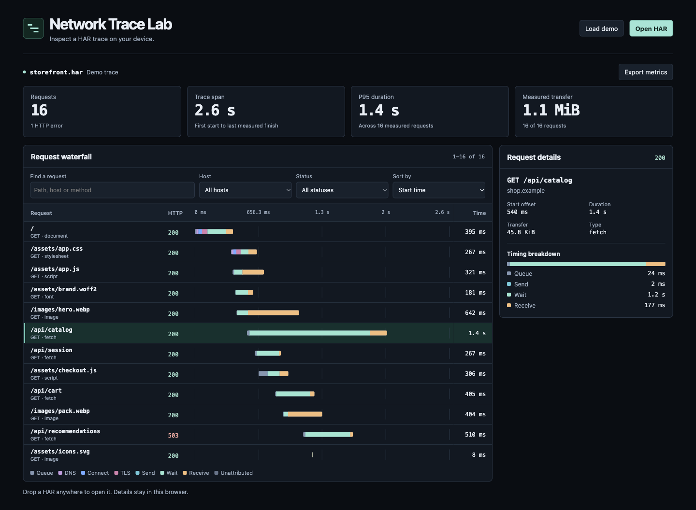

# Network Trace Lab

An interactive network waterfall for HTTP Archive files. Open a trace, identify which requests are slow, and see where each one spent its time.

## Start

Open [dist/index.html](dist/index.html) in a browser. The app starts with a synthetic trace. Use **Open HAR** or drop in a local file to inspect your own capture. Chrome DevTools can export a HAR from its Network panel. [Chrome DevTools HAR export](https://developer.chrome.com/docs/devtools/network/reference#save-as-har)

- Search by path, host, method, or resource type. Filter by host or HTTP status and sort by duration or transfer size.
- Select a request to see its start offset, duration, and timing phases. TLS time is shown within the connection phase budget.
- Use **Export metrics** to download aggregate JSON containing counts, timing, and measured transfer sizes.

The app processes files up to 25 MiB on the device. The inspector displays the host and path. The metrics export contains aggregate values and leaves out request URLs, headers, and bodies. Transfer totals include requests with a reported transfer size or known header and body sizes.

## Develop

Run **npm test** to check timing, metrics, filtering, and invalid entries. Run **npm run build** to rebuild the standalone HTML from the source files. The build and tests use Node.js and have no package dependencies.
